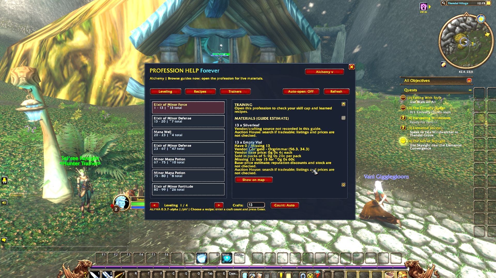
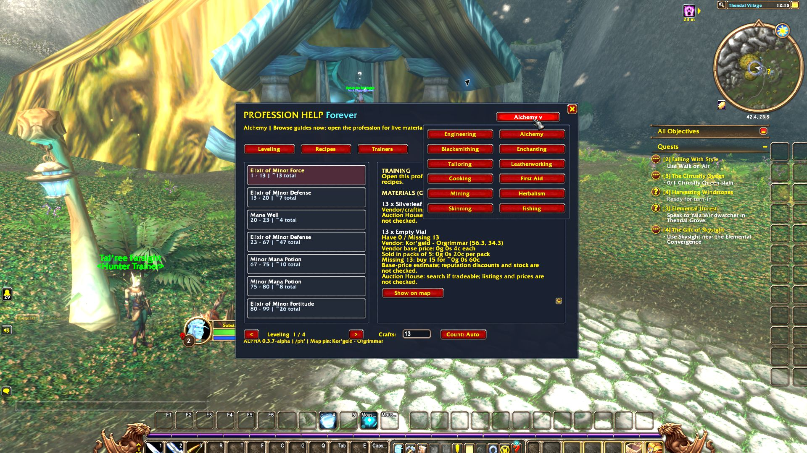
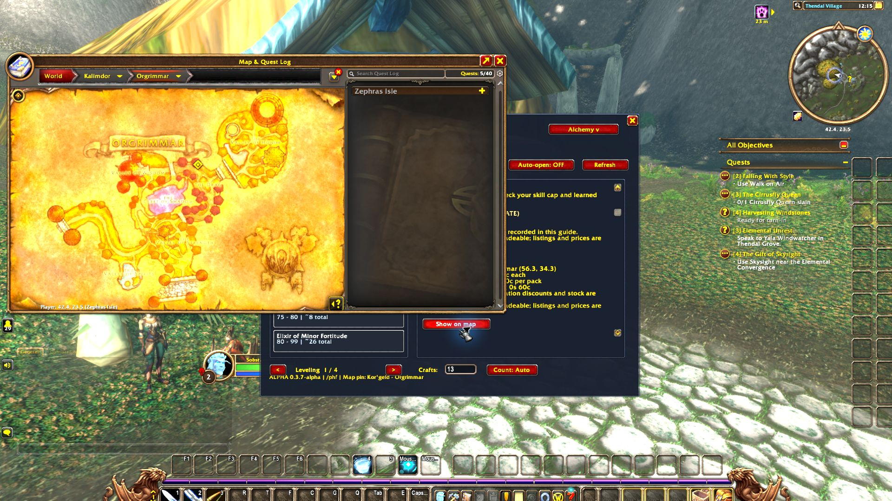

# Profession Help Forever

**Know what to craft, what to keep, and where to go next.**

A free in-game profession companion for the Blizzard **World of Warcraft: Forever** client. Browse all 12 supported professions from one window, follow suggested 1-300 leveling steps, and find the supplies and trainers you need.

[Download the addon](https://github.com/sobata1995-source/ProfessionHelpForever/releases) · [Discord community](https://discord.gg/Pr5eMAUqt) · [Report a bug](https://github.com/sobata1995-source/ProfessionHelpForever/issues)

## What it does

- **Crafting guides:** suggested 1-300 routes for Engineering, Alchemy, Blacksmithing, Enchanting, Tailoring, Leatherworking, Cooking and First Aid.
- **Remaining crafts:** estimates update from your current skill, with material totals refreshed after crafting. Completed steps advance automatically.
- **Gathering guides:** Mining, Herbalism, Skinning and Fishing zone suggestions follow your skill. Area map pins help you find the suggested zone.
- **Training guidance:** rank warnings and known faction-appropriate trainer locations, with Show on map.
- **Material sources:** vendor names, coordinates, crafting references and initial gathering/loot guidance directly beneath the material. Known vendors have their own map buttons.
- **Keep / Sell:** later recipe requirements and possible uses by other professions, also shown in bag tooltips.
- **Vendor costs:** recorded base prices and estimated missing-material purchase totals, including pack sizes.
- **Recipe vendors:** mapped sources for catalogued vendor-sold recipes.
- **Easy access:** profession selector, minimap button and `/phf`. No popup on login; automatic opening is optional.

## Install

1. Download **ProfessionHelpForever-0.3.7-alpha.zip** from Releases.
2. Extract the `ProfessionHelpForever` folder into `_forever_/Interface/AddOns/`.
3. Enable the addon, then use `/reload` if the game is already open.
4. Open `/phf` or click the minimap button. Open your profession for live recipe and material data.

This package is for **Forever 1.60.1 / Interface 16001**. The [original Profession Help for WoW 3.3.5a](https://github.com/sobata1995-source/ProfessionHelp) is a separate addon.

## Alpha status

This is an early public alpha. Craft counts are estimates, not guaranteed skill-ups. Later gathering routes still need live verification. Coverage is English-first and incomplete: not every vendor, recipe, drop or quest is recorded. Gathering pins mark approximate zone centres, not exact resource spawns.

Keep / Sell covers direct requirements in the bundled leveling routes. It does not prove an item is useless elsewhere. Bank items, indirect component requirements, reputation discounts and live AH listings are not included. Vendor costs use recorded base prices and pack sizes. Nothing is automatically bought, sold, crafted or deleted.

Automated Lua mock tests cover event handling, skill progression, material calculations, maps and tooltips. Real client previews are included below; this does not imply every route has been tested in game.

## Free addon — optional support

Profession Help Forever is **free to download and use**. If it helps you, you can support development with a donation or leave a tip. Support is optional; feedback and bug reports help too.

[**Donate / leave a tip with Revolut**](https://revolut.me/denisar2z) · [**Support on Patreon**](https://www.patreon.com/c/DenisAleksandrov/membership) · [**Join Discord**](https://discord.gg/Pr5eMAUqt)

## Screenshots

Real screenshots captured in the Forever client (0.3.7-alpha).

## Credits and data

See [SOURCES.txt](ProfessionHelpForever/SOURCES.txt) for guide and trainer references. This community addon is not affiliated with Blizzard Entertainment.
